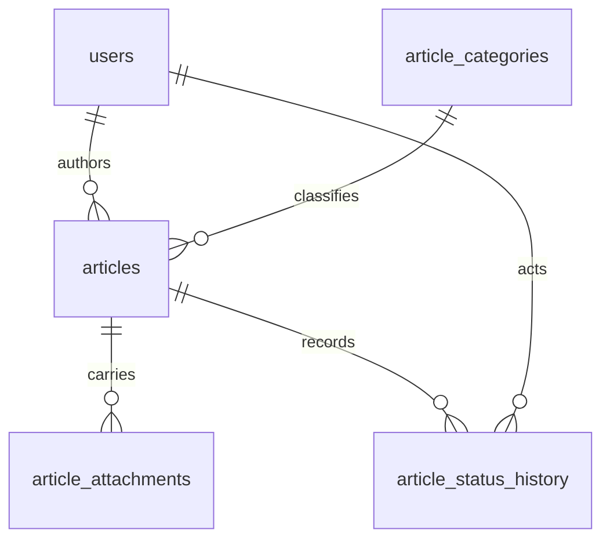

# Articles & Editorial — Architecture

**Module:** `App\Modules\Articles`
**Version:** 1.0 (initial backend slice)
**Sources:** SRS v1.1 §3, §4.2, §5, §6.1; Backend guide §3, §4.2, §5.1, §6.1, §8; Backend modular tasks §3, §5.2, §6.1; Frontend tasks §3, §4

---

## 1. Design decisions

| Decision | Rationale |
|---|---|
| Six-state editorial machine owned by one service | `ArticleWorkflowService` is the only writer of article state. Controllers are thin, so the transition table cannot drift between public, publisher and admin surfaces. |
| Public visibility is a **status** question, not an identity question | `ArticleStatus::isPublic()` is `published` only. A draft, pending, rejected or unpublished article is a `404` for anonymous readers — never a `403` that leaks existence. |
| Append-only status history | `article_status_history` rows are only ever inserted, never updated or deleted. The history is the audit trail for *editorial* changes; `audit_logs` remains the system-wide trail. |
| Slug is the public identifier | ULIDs stay internal; URLs use a human-readable, deduplicated slug (`title-slug`, `title-slug-2`, …). |
| Slug re-derived on title change | Editing a draft title re-derives the slug and re-checks uniqueness, so a renamed article never leaves an orphaned URL. |
| Domain events after commit | `ArticleStatusChanged`, `ArticlePublished` and `ArticleUnpublished` implement `ShouldDispatchAfterCommit`, so listeners never observe uncommitted state. |
| No cross-module table joins | "Popular" sorting uses `is_featured` + `published_at` only. Vote totals belong to the Voting module; Articles never joins `votes`. |
| Sorting and filtering are model scopes | Client input reaches an allow-list (`scopeSort`), never raw SQL. |
| Media & attachments integrated natively | The Articles module directly handles attachment file uploads, validation (PDF, JPEG, PNG <= 10MB), secure storage disk abstraction (local/S3), download streaming, and publisher deletion. |

---

## 2. Directory architecture

```text
backend/app/Modules/Articles/
├── Database/
│   ├── Factories/
│   │   ├── ArticleCategoryFactory.php
│   │   └── ArticleFactory.php
│   ├── Migrations/
│   │   ├── ..._create_article_categories_table.php
│   │   ├── ..._create_articles_table.php
│   │   ├── ..._create_article_attachments_table.php
│   │   └── ..._create_article_status_history_table.php
│   └── Seeders/ArticleCategorySeeder.php
├── Enums/ArticleStatus.php
├── Exceptions/ArticleException.php
├── Events/
│   ├── ArticleStatusChanged.php
│   ├── ArticlePublished.php
│   └── ArticleUnpublished.php
├── Http/
│   ├── Controllers/Api/V1/
│   │   ├── Public/{PublicArticleController,PublicCategoryController}.php
│   │   ├── Publisher/PublisherArticleController.php
│   │   └── Admin/AdminArticleController.php
│   ├── Requests/{StoreArticleDraftRequest,UpdateArticleRequest,RejectArticleRequest,FeatureArticleRequest}.php
│   └── Resources/{ArticleListResource,ArticleDetailResource,ArticleCategoryResource}.php
├── Models/{Article,ArticleCategory,ArticleAttachment,ArticleStatusHistory}.php
├── Policies/ArticlePolicy.php
├── Providers/ArticlesServiceProvider.php
├── Routes/api.php
└── Services/ArticleWorkflowService.php
```

Registered in `bootstrap/providers.php`; routes are mounted from `routes/api.php`.

---

## 3. Editorial state machine

```text
   ┌───────┐   publish (article.publish_own)   ┌───────────┐
   │ draft │──────────────────────────────────▶│ published │
   └───────┘                                   └───────────┘
                                                     │ ▲
                       unpublish (article.unpublish) │ │ publish (article.publish_any)
                                                     ▼ │
                                               ┌─────────────┐
                                               │ unpublished │
                                               └─────────────┘
```

Allowed transitions (enforced in `ArticleWorkflowService::TRANSITIONS`):

| From | To |
|---|---|
| `draft` | `draft` (edit), `published` (direct publish by publisher or admin) |
| `published` | `unpublished` (admin removal only) |
| `unpublished` | `published` (admin republish) |

Any other transition raises `ArticleException::invalidTransition` → `409`
with code `article_invalid_transition`. A refused transition writes **no**
history row and **no** audit entry.

`published_at` is stamped on every transition into `published` and is
cleared only by soft deletion — an `unpublished` article keeps the original
publication timestamp for reporting.

---

## 4. Data model

### 4.1 Tables

| Table | Purpose |
|---|---|
| `article_categories` | ULID, name, unique slug, description |
| `articles` | ULID, `author_id`, `category_id`, title, unique slug, abstract, body, status, `is_featured`, `published_at`, soft deletes |
| `article_attachments` | ULID, `article_id`, original name, mime type, size, kind (`document`/`image`), created_at |
| `article_status_history` | ULID, `article_id`, `from_status`, `to_status`, `acted_by`, `reason`, created_at — **append only** |

### 4.2 Relationships



### 4.3 Indexes and invariants

- `articles.slug` unique (soft-deleted rows still occupy the index, so slug
  generation checks with `withTrashed()`).
- `articles.category_id` and `articles.author_id` are indexed.
- `article_categories.slug` unique.
- `article_status_history` is indexed by `(article_id, created_at)`.
- `article_status_history` has no `updated_at` — rows are immutable.
- `article_attachments.article_id` is indexed.

---

## 5. Permissions

The module consumes the Identity permission set; it never defines its own.

| Permission | Grants |
|---|---|
| `article.create` | Create a draft; read the publisher workspace |
| `article.update_own` | Edit **your own** article while it is `draft` or `rejected` |
| `article.submit` | Send **your own** article for review |
| `article.publish_own` | Publish **your own** article directly — only present while an active `publisher_permissions` grant has `can_publish_directly = 1` |
| `article.review` | Approve / reject submissions, read the review queue |
| `article.publish_any` | Publish any article (approved, draft or unpublished) |
| `article.unpublish` | Unpublish a live article |
| `article.feature` | Toggle the featured flag |

Route middleware uses `permission:<a>,<b>`, which means **any** of the listed
permissions. `ArticlePolicy` adds ownership checks on top:

```text
updateOwn  = owns(article) && status ∈ {draft, rejected} && has article.update_own
submit     = owns(article) && status ∈ {draft, rejected} && has article.submit
publishOwn = owns(article) && has article.publish_own
viewOwn    = owns(article) || has article.review || has article.publish_any
```

Admin routes additionally require `staff.mfa` (confirmed TOTP).

---

## 6. Endpoint contract

All paths are relative to `/api/v1`.

### 6.1 Public

| Method | Path | Access | Notes |
|---|---|---|---|
| GET | `/articles` | Public | Published only. `search`, `category` (slug), `sort` (`newest`\|`popular`), `page`, `per_page` (max 100) |
| GET | `/articles/{slug}` | Public | Published only; resolves slug **or** ULID. `404` for every other status |
| GET | `/articles/{article}/attachments/{attachment}/download` | Public / Authorized | Stream or signed download of attachment (public if article is published; owner/editor if draft/unpublished) |
| GET | `/article-categories` | Public | Categories with published article counts |

### 6.2 Publisher workspace

| Method | Path | Permission | Notes |
|---|---|---|---|
| GET | `/publisher/articles` | `article.create` | List owned articles |
| POST | `/publisher/articles` | `article.create` | Create draft |
| GET | `/publisher/articles/{article}` | owner, `article.review` or `article.publish_any` | Get single article detail |
| PATCH | `/publisher/articles/{article}` | `article.update_own` | Update title, abstract, body, category |
| POST | `/publisher/articles/{article}/submit` | `article.submit` | Transition to pending_review |
| POST | `/publisher/articles/{article}/publish` | `article.publish_own` | Direct-publish if granted |
| POST | `/publisher/articles/{article}/attachments` | `article.update_own` | Multipart file upload (PDF/PNG/JPEG/WEBP <= 10MB) |
| DELETE | `/publisher/articles/{article}/attachments/{attachment}` | `article.update_own` | Delete attachment file and record |

### 6.3 Editorial administration

| Method | Path | Permission |
|---|---|---|
| GET | `/admin/articles` | `article.review` **or** `article.publish_any` |
| GET | `/admin/articles/review-queue` | `article.review` |
| POST | `/admin/articles/{article}/approve` | `article.review` |
| POST | `/admin/articles/{article}/reject` | `article.review` (body: `reason`, min 5 chars) |
| POST | `/admin/articles/{article}/publish` | `article.publish_any` |
| POST | `/admin/articles/{article}/unpublish` | `article.unpublish` |
| POST | `/admin/articles/{article}/feature` | `article.feature` (body: `is_featured`) |

### 6.4 Response shapes

```json
// GET /articles
{
  "data": [
    {
      "id": "01J...",
      "title": "Machine Learning for Triage in Rural Clinics",
      "slug": "machine-learning-for-triage-in-rural-clinics",
      "abstract": "A field study on lightweight triage models …",
      "category": { "id": "01J...", "name": "AI in Medicine", "slug": "ai-in-medicine" },
      "author": { "id": "01J...", "name": "Dr. Nimali Perera" },
      "status": "published",
      "status_label": "Published",
      "is_featured": false,
      "votes_count": 0,
      "published_at": "2026-01-01T09:00:00+00:00",
      "created_at": "2026-01-01T08:30:00+00:00"
    }
  ],
  "meta": { "current_page": 1, "per_page": 12, "total": 1, "last_page": 1 }
}
```

`GET /articles/{slug}` adds `body`, `attachments[]` and (for privileged
callers) `status_history[]`.

> **Vote-count seam.** `votes_count` on public `/articles` responses is
> emitted as `0`. Vote totals are owned by `App\Modules\Voting`
> (`article_vote_summaries`), and Articles never reads another module's tables.
> Authenticated participants receive live counts and standings from the Voting
> module endpoints (`/articles/{article}/vote-results` and `/leaderboard`,
> enforcing `FR-38`), while `sort=popular` orders by *featured first, then newest*.

Errors use the shared envelope:

```json
{
  "message": "Articles cannot move from [draft] to [rejected].",
  "code": "article_invalid_transition",
  "request_id": "01J...",
  "errors": {
    "status": ["Articles cannot move from [draft] to [rejected]."]
  }
}
```

Full schemas: `openapi/openapi.yaml` (tags `Articles`, `Publisher`).

---

## 7. Events

| Event | Dispatched when |
|---|---|
| `ArticleStatusChanged` | any successful transition (carries `from`, `to`, actor, reason) |
| `ArticlePublished` | transition into `published` |
| `ArticleUnpublished` | transition into `unpublished` |

All three implement `ShouldDispatchAfterCommit`, so listeners (Analytics,
Notifications, Search indexing) observe committed state only.

---

## 8. Audit trail

Every workflow write is recorded through `Shared\Contracts\AuditLogger`:

| Action | Recorded on |
|---|---|
| `article.created` | draft creation |
| `article.updated` | draft update (includes `slug_changed`) |
| `article.status.{status}` | every transition (`from`, `to`, `reason`, `slug`) |
| `article.featured` | featured flag change |

The audit subject is the article ULID; actor and request metadata (request ID,
hashed IP) are attached by the Audit module.

---

## 9. Test strategy

| Suite | Coverage |
|---|---|
| `PublicArticleTest` | published-only listing, search/category filters, slug lookup, 404 for every other status, category counts, history hidden from the public, publisher routes require authentication |
| `PublisherWorkflowTest` | draft creation and validation, permission gates, cross-author edit protection, own-draft editing, submit, double-submit refusal, direct publish blocked without a grant, allowed with a grant, revoked when the grant is switched off, workspace isolation |
| `AdminEditorialTest` | review queue, approve, reject with reason, publish any, unpublish, feature toggle, permission and MFA gates, history growth per transition |
| `ArticleStatusHistoryTest` | append-only history, actor and reason recorded, no row for a refused transition, published timestamp sync, unique slug generation |

Commands:

```bash
php artisan test tests/Feature/Modules/Articles
./vendor/bin/pint --test
```

---

## 10. Frontend integration

The React SPA talks to this module through `Frontend/src/services/articleService.ts`
and authenticates via `Frontend/src/services/authService.ts`:

- `apiClient.ts` sends `credentials: "include"`, reads the Sanctum
  `XSRF-TOKEN` cookie and echoes it as `X-XSRF-TOKEN` for mutating calls.
- Vite proxies `/api` and `/sanctum` to `VITE_BACKEND_URL` (default
  `http://localhost:8000`) so the cookie session works without CORS.
- `mapArticle()` in `Frontend/src/store.tsx` converts the API DTOs into the
  UI `Article` shape; the public catalogue (`/articles`), the detail page
  (`/articles/:id`), the dedicated publisher studio (`/publisher`,
  `/publisher/create`, `/publisher/edit/:id`), and the admin review queue
  (`/admin/articles`) all read from the API rather than from mock data.
- When the API is unreachable the catalogue keeps the last cached list and
  shows an explicit offline notice (`ApiUnavailableError`).

---

## 11. Deferred / next steps

1. **Search**: full-text index instead of `LIKE` once the corpus grows.
2. **Scheduled unpublishing** and scheduled publication windows.
3. **Article version history** for concurrent editor collaboration.
4. **OpenAPI contract tests** and CI (Pint + Pest + migration check).
