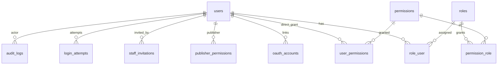

# Identity & Access Management — Architecture

**Module:** `App\Modules\Identity`
**Version:** 1.0 (initial backend slice)
**Sources:** SRS v1.1 §3, §4.2, §5, §6.1; Backend guide §3, §4.2, §5.1, §6.1, §8; Backend modular tasks §3, §5.2, §6.1

---

## 1. Design decisions

| Decision | Rationale |
|---|---|
| Laravel 12 modular monolith | Matches the approved backend design: one deployable, one database, explicit module boundaries. |
| Readers: **Google OAuth only** | No reader passwords means no credential stuffing, no reader password resets, and Google-verified email. Registration is automatic on first verified sign-in. |
| Staff: **password + TOTP** | Staff accounts are invite-only. Social login is explicitly rejected for staff so Google can never bypass MFA. |
| Sanctum **HttpOnly cookie sessions** for the SPA | Recommended by the backend guide. No tokens in browser storage. Bearer tokens remain possible for trusted clients/tests. |
| RBAC = roles **∪** direct grants **∪** publisher capability | The SRS requires independent participant/publisher capabilities; a user can hold both. |
| `article.publish_own` is **not** a publisher-role permission | It is injected only while an active `publisher_permissions` row has `can_publish_directly = 1`. This is the server-side enforcement of FR-19. |
| Server-side OAuth `state` in cache | Single-use, 10-minute, hashed key. Protects the callback against login CSRF without relying on cross-site cookies. |
| Append-only audit module | Identity actions are audited through `Shared\Contracts\AuditLogger`; Audit owns the table. No cross-module writes. |
| ULIDs externally and internally | Opaque IDs, safe to expose, index-friendly, non-enumerable. |

---

## 2. Directory architecture

```text
backend/
├── app/
│   ├── Modules/
│   │   ├── Identity/
│   │   │   ├── Console/
│   │   │   │   └── CreateAdministratorCommand.php      identity:create-admin
│   │   │   ├── Contracts/
│   │   │   │   └── IdentityAccess.php                  public contract for other modules
│   │   │   ├── Database/
│   │   │   │   ├── Factories/UserFactory.php
│   │   │   │   ├── Migrations/
│   │   │   │   │   ├── ..._create_users_table.php
│   │   │   │   │   ├── ..._create_oauth_accounts_table.php
│   │   │   │   │   ├── ..._create_access_control_tables.php
│   │   │   │   │   └── ..._create_identity_security_tables.php
│   │   │   │   └── Seeders/RolePermissionSeeder.php
│   │   │   ├── Events/
│   │   │   │   ├── UserRegistered.php
│   │   │   │   ├── UserSignedIn.php
│   │   │   │   ├── UserDeactivated.php
│   │   │   │   ├── RoleAssigned.php
│   │   │   │   ├── RoleRevoked.php
│   │   │   │   ├── PermissionGranted.php
│   │   │   │   ├── PermissionRevoked.php
│   │   │   │   ├── PublisherPermissionChanged.php
│   │   │   │   ├── TwoFactorStatusChanged.php
│   │   │   │   └── StaffInvited.php
│   │   │   ├── Exceptions/IdentityException.php
│   │   │   ├── Http/
│   │   │   │   ├── Controllers/Api/V1/
│   │   │   │   │   ├── Auth/
│   │   │   │   │   │   ├── GoogleRedirectController.php
│   │   │   │   │   │   ├── GoogleCallbackController.php
│   │   │   │   │   │   ├── StaffLoginController.php
│   │   │   │   │   │   ├── StaffMfaVerifyController.php
│   │   │   │   │   │   ├── StaffMfaSetupController.php
│   │   │   │   │   │   ├── StaffInvitationAcceptController.php
│   │   │   │   │   │   ├── StaffForgotPasswordController.php
│   │   │   │   │   │   ├── StaffResetPasswordController.php
│   │   │   │   │   │   └── LogoutController.php
│   │   │   │   │   ├── Admin/
│   │   │   │   │   │   ├── AdminUserController.php
│   │   │   │   │   │   ├── AdminUserRoleController.php
│   │   │   │   │   │   ├── AdminUserPermissionController.php
│   │   │   │   │   │   ├── AdminPublisherPermissionController.php
│   │   │   │   │   │   ├── AdminStaffInvitationController.php
│   │   │   │   │   │   └── AdminRoleController.php
│   │   │   │   │   ├── MeController.php
│   │   │   │   │   ├── MeSessionsController.php
│   │   │   │   │   └── TwoFactorController.php
│   │   │   │   ├── Middleware/
│   │   │   │   │   ├── EnsureUserIsActive.php
│   │   │   │   │   └── RequireStaffTwoFactor.php
│   │   │   │   ├── Requests/        (15 validated form requests)
│   │   │   │   └── Resources/       Me, User, AdminUser, Role, StaffInvitation
│   │   │   ├── Models/
│   │   │   │   ├── User.php
│   │   │   │   ├── OAuthAccount.php
│   │   │   │   ├── Role.php
│   │   │   │   ├── Permission.php
│   │   │   │   ├── UserPermission.php
│   │   │   │   ├── PublisherPermission.php
│   │   │   │   ├── StaffInvitation.php
│   │   │   │   ├── LoginAttempt.php
│   │   │   │   ├── PersonalAccessToken.php
│   │   │   │   └── Concerns/HasRolesAndPermissions.php
│   │   │   ├── Notifications/
│   │   │   │   ├── StaffInvitationNotification.php
│   │   │   │   └── StaffPasswordResetNotification.php
│   │   │   ├── Policies/UserPolicy.php
│   │   │   ├── Providers/IdentityServiceProvider.php
│   │   │   ├── Routes/api.php
│   │   │   ├── Services/
│   │   │   │   ├── GoogleAuthenticationService.php
│   │   │   │   ├── OAuthStateService.php
│   │   │   │   ├── StaffAuthenticationService.php
│   │   │   │   ├── LoginChallengeService.php
│   │   │   │   ├── TwoFactorService.php
│   │   │   │   ├── SessionService.php
│   │   │   │   ├── StaffInvitationService.php
│   │   │   │   ├── RoleService.php
│   │   │   │   ├── PermissionGrantService.php
│   │   │   │   ├── PublisherPermissionService.php
│   │   │   │   ├── PermissionResolver.php
│   │   │   │   ├── IdentityAccessService.php
│   │   │   │   ├── UserManagementService.php
│   │   │   │   └── ProfileService.php
│   │   │   └── Support/ (reserved for module helpers)
│   │   └── Audit/
│   │       ├── Database/Migrations/..._create_audit_logs_table.php
│   │       ├── Models/AuditLog.php
│   │       ├── Providers/AuditServiceProvider.php
│   │       └── Services/DatabaseAuditLogger.php
│   ├── Shared/
│   │   ├── Contracts/{ApiError,AuditLogger}.php
│   │   ├── Exceptions/ApiExceptionRenderer.php
│   │   ├── Http/Middleware/
│   │   │   ├── AuthorizePermission.php
│   │   │   ├── ForceHttps.php
│   │   │   ├── RequestId.php
│   │   │   └── SecurityHeaders.php
│   │   ├── Http/Responses/ApiResponse.php
│   │   └── Support/{EmailNormalizer,IpHasher}.php
│   └── Providers/AppServiceProvider.php
├── bootstrap/{app.php,providers.php}
├── config/{app,auth,cache,cors,database,identity,logging,sanctum,services,session}.php
├── database/
│   ├── migrations/ (cache/jobs framework tables)
│   └── seeders/DatabaseSeeder.php
├── docs/identity-and-access.md
├── openapi/openapi.yaml
├── routes/{api,web,console}.php
├── tests/
│   ├── Feature/Modules/Identity/
│   │   ├── GoogleAuthenticationTest.php
│   │   ├── StaffAuthenticationTest.php
│   │   ├── RbacTest.php
│   │   └── StaffInvitationTest.php
│   ├── Pest.php
│   └── TestCase.php
├── composer.json
└── README.md
```

---

## 3. Request lifecycle

```text
Request
  ├── RequestId            → X-Request-ID (validated or ULID)
  ├── ForceHttps           → production 308 redirect
  ├── SecurityHeaders      → CSP/HSTS/nosniff/frame/referrer/no-store
  ├── Sanctum stateful     → cookie session (stateful domains) or bearer
  ├── auth:sanctum         → 401 envelope
  ├── active               → deactivated account 403
  ├── staff.mfa            → staff without confirmed TOTP 403
  ├── permission:<name>    → effective-permission check 403
  ├── FormRequest          → validation 422 envelope
  ├── Controller           → thin; delegates to a service
  ├── Service              → transaction, invariants, event, audit
  └── Resource             → {"data": ...}
```

Errors are rendered by `Shared\Exceptions\ApiExceptionRenderer`:

```json
{
  "message": "The provided credentials are incorrect.",
  "code": "invalid_credentials",
  "request_id": "01J..."
}
```

Success: `{"data": ...}` with `meta` on paginated lists.

---

## 4. Data model

### 4.1 Tables

| Table | Owner | Purpose |
|---|---|---|
| `users` | Identity | ULID, normalized unique email, nullable password (readers), active flag, lockout counters, TOTP fields, soft deletes |
| `oauth_accounts` | Identity | `(provider, provider_user_id)` unique; one Google identity per user/provider |
| `roles` | Identity | `participant`, `publisher`, `administrator` (system-managed) |
| `permissions` | Identity | 19 fine-grained permissions |
| `role_user` | Identity | Composite PK; `assigned_by` |
| `permission_role` | Identity | Role → permission matrix |
| `user_permissions` | Identity | Direct, time-bound grants; unique `(user_id, permission_id)` |
| `publisher_permissions` | Identity | Active grant history; `can_publish_directly`; single active grant per user on MySQL via generated column |
| `staff_invitations` | Identity | SHA-256 token hash, role, expiry, accepted_at |
| `login_attempts` | Identity | Email, hashed IP, result, user agent, timestamp |
| `password_reset_tokens` | Identity | Staff-only password broker |
| `sessions` | Identity | Database session driver (Sanctum cookies) |
| `personal_access_tokens` | Identity | Sanctum bearer tokens (ULID) |
| `audit_logs` | Audit | Append-only; no updated_at, no FKs, hashed IP |

### 4.2 Relationships



### 4.3 Indexes and invariants

- `users.email` unique; all writes normalize to lowercase.
- `oauth_accounts` unique `(provider, provider_user_id)` and `(user_id, provider)`.
- `user_permissions` unique `(user_id, permission_id)`; expired rows ignored at read time.
- `publisher_permissions`: one active row per user (MySQL generated column + unique index; service-level lock for other drivers).
- `staff_invitations.token_hash` unique; plaintext token exists only in the email.
- `audit_logs` append-only; indexed by subject and actor/time.

---

## 5. RBAC

### 5.1 Resolution

```text
effective_permissions(user) =
      permissions of all assigned roles
    ∪ non-expired direct user_permissions
    ∪ { "article.publish_own" }   if an active publisher grant has can_publish_directly
```

Cached in `identity:permissions:{userId}` (default 300 s) and explicitly
invalidated after every role/grant mutation.

### 5.2 Permission matrix

| Permission | Participant | Publisher | Administrator |
|---|:---:|:---:|:---:|
| `participant.vote` | ✓ | | ✓ |
| `participant.comment` | ✓ | | ✓ |
| `participant.view_results` | ✓ | | ✓ |
| `article.create` | | ✓ | ✓ |
| `article.submit` | | ✓ | ✓ |
| `article.update_own` | | ✓ | ✓ |
| `article.publish_own` | | grant* | ✓ |
| `article.review` | | | ✓ |
| `article.publish_any` | | | ✓ |
| `article.unpublish` | | | ✓ |
| `article.feature` | | | ✓ |
| `comment.moderate` | | | ✓ |
| `content.manage` | | | ✓ |
| `user.manage` | | | ✓ |
| `publisher.manage` | | | ✓ |
| `analytics.view_own` | | ✓ | ✓ |
| `analytics.view_all` | | | ✓ |
| `settings.manage` | | | ✓ |
| `audit.view` | | | ✓ |

\* only while `publisher_permissions.can_publish_directly = 1` and `revoked_at` is null.

### 5.3 Guard rails

- Administrators cannot change their own roles or direct permissions.
- Only an administrator can grant/revoke `administrator`.
- The last active administrator cannot be demoted or deactivated.
- Sensitive permissions (`user.manage`, `publisher.manage`, `settings.manage`,
  `audit.view`, `article.publish_any`) cannot be granted directly — role only.
- Revoking a publisher grant removes the `publisher` role and all publisher
  permissions.
- Every change is audited with actor, subject, timestamp and hashed IP.

---

## 6. Authentication flows

### 6.1 Reader — Google OAuth (registration = first sign-in)

```text
SPA                     API                                  Google
 │ GET /auth/google/redirect                                │
 │────────────────────────▶│ issue 64-char state (cache 10m)  │
 │◀────────────────────────│ authorization_url                │
 │ browser navigates ──────────────────────────────────────▶ │
 │                                                          │ consent
 │◀────────── GET /auth/google/callback?code&state ──────────│
 │                         │ consume state (single use)       │
 │                         │ exchange code (client secret)    │
 │                         │ require email_verified = true    │
 │                         │ link oauth_account OR create user│
 │                         │ attach participant role          │
 │                         │ audit auth.google.signed_in      │
 │◀── 302 FRONTEND/auth/callback?auth=success ───────────────│
 │ GET /me (HttpOnly session cookie)                         │
```

Failure redirects carry only `auth=error&reason=<safe_code>`; no email,
provider payload or token is ever placed in a URL.

Rules:

- Google sign-in is **readers only**. If the email belongs to a password-bearing
  staff account, the callback fails with `staff_use_password`.
- Inactive accounts fail with `account_inactive`.
- Replays of the state fail with `invalid_state`.
- Linking by email only happens for accounts without a password (readers).

### 6.2 Staff — first login (TOTP enrolment)

```text
POST /auth/staff/login {email,password}
  ├─ lockout check (423)
  ├─ constant-time password check (dummy hash for unknown accounts)
  ├─ on failure: increment counter, lock after 5, generic 401
  └─ on success:
       no confirmed TOTP → 202 {status: mfa_setup_required, challenge_token}
POST /auth/staff/mfa/setup {token}
  └─ 200 {secret, otpauth_url, qr_svg}
POST /auth/staff/mfa/setup/confirm {token, code}
  ├─ verify TOTP
  ├─ store 8 hashed recovery codes, set confirmed_at
  └─ establish session + return recovery codes once
```

The challenge token is random, hashed in the cache, single-use, expires in
5 minutes and is burnt after 5 failed verifications. No session exists until
MFA succeeds.

### 6.3 Staff — returning login

```text
POST /auth/staff/login → 202 {status: mfa_required, challenge_token}
POST /auth/staff/mfa/verify {token, code | recovery_code}
  ├─ success → session + 200
  └─ failure → 422, burnt after 5 attempts
```

### 6.4 Staff invitation

1. Administrator (with confirmed TOTP) calls
   `POST /admin/staff-invitations {email, role}`.
2. Only `publisher` / `administrator` roles are allowed; optional allowed-domain
   list is enforced.
3. Token (64 random chars) is stored as SHA-256 only; email delivery is
   synchronous so the plaintext never lands in the queue table.
4. Invitee opens the frontend link and posts
   `POST /auth/staff/invitations/accept {token, name, password}`.
5. Password policy: min 12, mixed case, number, symbol, and (in production)
   HaveIBeenPwned `uncompromised` check.
6. Account is created with the invited role, session is established, and the
   staff member still has to enrol TOTP before admin routes unlock.

### 6.5 Password reset (staff only)

`POST /auth/staff/forgot-password` always returns the same 202 message.
`POST /auth/staff/reset-password` uses Laravel's broker (30-minute token),
invalidates every session/token, and audits the reset.

### 6.6 Session control

- `POST /auth/logout` revokes the current token (if any) and destroys the session.
- `DELETE /me/sessions` deletes all other database sessions and tokens.
- Deactivation, password reset and MFA removal revoke **all** sessions.

---

## 7. Endpoint contract (IAM)

All paths are relative to `/api/v1`.

| Method | Path | Access | Rate limit |
|---|---|---|---|
| GET | `/auth/google/redirect` | Public | 10/min/IP |
| GET | `/auth/google/callback` | Public | 10/min/IP |
| POST | `/auth/staff/login` | Public | 5/min/email+IP |
| POST | `/auth/staff/mfa/verify` | Challenge token | 5/min/IP |
| POST | `/auth/staff/mfa/setup` | Setup token | 5/min/IP |
| POST | `/auth/staff/mfa/setup/confirm` | Setup token | 5/min/IP |
| POST | `/auth/staff/invitations/accept` | Invitation token | 5/hour/IP |
| POST | `/auth/staff/forgot-password` | Public | 5/min/email+IP |
| POST | `/auth/staff/reset-password` | Reset token | 5/min/email+IP |
| POST | `/auth/logout` | Auth | — |
| GET | `/me` | Auth | — |
| PATCH | `/me` | Auth | — |
| DELETE | `/me/sessions` | Auth | 10/min/user |
| POST | `/me/two-factor/setup` | Auth | — |
| POST | `/me/two-factor/confirm` | Auth | — |
| POST | `/me/two-factor/disable` | Auth | 5/min/IP |
| GET | `/admin/users` | `user.manage` + staff MFA | — |
| GET | `/admin/users/{user}` | `user.manage` + staff MFA | — |
| PATCH | `/admin/users/{user}` | `user.manage` + staff MFA | — |
| POST/DELETE | `/admin/users/{user}/roles` | `user.manage` + staff MFA | — |
| POST/DELETE | `/admin/users/{user}/permissions` | `user.manage` + staff MFA | — |
| POST/PATCH/DELETE | `/admin/users/{user}/publisher-permission` | `publisher.manage` + staff MFA | — |
| GET/POST | `/admin/staff-invitations` | `user.manage` + staff MFA | — |
| GET | `/admin/roles` | `user.manage` + staff MFA | — |

Full schemas: `openapi/openapi.yaml`.

---

## 8. Security controls mapped to requirements

| Control | Implementation | Requirement |
|---|---|---|
| Registration / login | Google OAuth; staff invite + password | FR-11, FR-12 |
| Password recovery | Staff-only broker + single-use hashed token | FR-13 |
| Authentication required | `auth:sanctum` + `active` middleware | FR-14 |
| RBAC | roles/permissions, resolver, `permission:` middleware, policies | FR-15 |
| Dual capability | independent `role_user` rows and publisher grants | FR-16 |
| Publishing authority | `article.publish_any` / `article.publish_own` | FR-17 |
| Grant/revoke publishing | PublisherPermissionService + admin endpoints + audit | FR-18 |
| Direct publish configuration | `can_publish_directly` injected into effective permissions | FR-19 |
| Secure session | HttpOnly, Secure (prod), SameSite=Lax, regeneration on login, revocation | §8.1 |
| CSRF | Sanctum stateful + `X-XSRF-TOKEN` | §8.1 |
| CORS | explicit origin allow-list, credentials only for those origins | §8.1 |
| Brute force | per-route rate limits + account lockout + login_attempts | §8.2 |
| Account enumeration | generic auth errors; uniform forgot-password response | §8.2 |
| MFA | TOTP + hashed recovery codes; enforced on staff/admin routes | §6.2 of backend guide |
| Secrets at rest | TOTP secret/recovery codes encrypted; invitation/reset tokens hashed | §8 |
| Privacy | raw IP never stored; HMAC-SHA256 IP hash only | §8.3 |
| Audit | append-only trail, actor/subject/metadata, redaction | §8.3 |
| Transport | HTTPS enforcement, HSTS, security headers | §8.1 |
| Request tracing | `X-Request-ID` on every response and error envelope | §8.3 |
| Error hygiene | no stack traces or credential detail; debug only in non-prod | §4.2 |

---

## 9. Configuration reference

`config/identity.php` groups:

- `frontend_url` — post-OAuth / email link base.
- `google.*` — scopes, state TTL, success/failure redirects.
- `staff.*` — roles, MFA requirement, password policy, lockout, challenge TTL,
  TOTP issuer/window, invitation TTL, allowed email domains, assignable roles.
- `publisher.direct_publish_permission`.
- `cache.permission_ttl_seconds`.
- `audit.hash_ip`.

Every production setting is environment-driven; secrets only via `.env` or a
secrets manager. Never commit `.env`.

---

## 10. Test strategy

| Area | Coverage |
|---|---|
| Google provisioning/linking | verified email, duplicate identity, unverified email, staff-email rejection, state replay |
| Staff auth | first-login setup challenge, TOTP challenge, wrong password, reader rejection, lockout, deactivated account |
| RBAC | role resolution, publisher gating, revoking role, expired direct grants, self-change protection, last-admin protection |
| Route policy | participant 403, staff MFA gate, admin 200 after enrolment |
| Invitations | email dispatch, one-time token, expiry, duplicate account, role restriction |
| Profile/errors | `/me` shape, email immutability, 401 envelope + request ID |

Commands:

```bash
php artisan test --testsuite=Feature
./vendor/bin/pint --test
```

---

## 11. Deferred / next steps

1. **Email transport**: wire SES/SMTP and queue invitations/resets in production
   (the token is intentionally not queued today).
2. **Redis**: move cache + rate limiting to Redis for multi-node deployments.
3. **PKCE**: optional hardening for the Google flow; the current confidential
   client uses a server-held secret and single-use state.
4. **Passkeys**: optional staff second factor / passwordless upgrade.
5. **Identity events consumers**: Audit currently records via the logger
   directly; Analytics/Notifications can subscribe to the emitted events.
6. **OpenAPI contract tests** and CI (Pint + Pest + migration check).
7. **Next module**: Content Management (`/public/*`, `/workshops`, CMS), then
   Articles & Editorial, Voting, Comments, Analytics, Integrations, Media.

---

## 12. Production checklist

- [ ] `APP_ENV=production`, `APP_DEBUG=false`, unique `APP_KEY`.
- [ ] HTTPS only; `SESSION_SECURE_COOKIE=true`; HSTS verified.
- [ ] `SESSION_DOMAIN` and `SANCTUM_STATEFUL_DOMAINS` match the SPA origin.
- [ ] `CORS_ALLOWED_ORIGINS` contains no wildcard.
- [ ] Google redirect URI registered exactly; OAuth consent screen verified.
- [ ] `STAFF_ALLOWED_EMAIL_DOMAINS` restricted to institutional domains.
- [ ] Mail transport tested; invitation/reset links resolve to the SPA.
- [ ] `php artisan migrate --force` via CI/CD; no manual schema edits.
- [ ] Queue worker + scheduler running; failed jobs monitored.
- [ ] Bootstrap admin created, TOTP enrolled, recovery codes stored offline.
- [ ] Database backups and restore drill completed.
- [ ] Logs redact `Authorization`, cookies, passwords and tokens.
