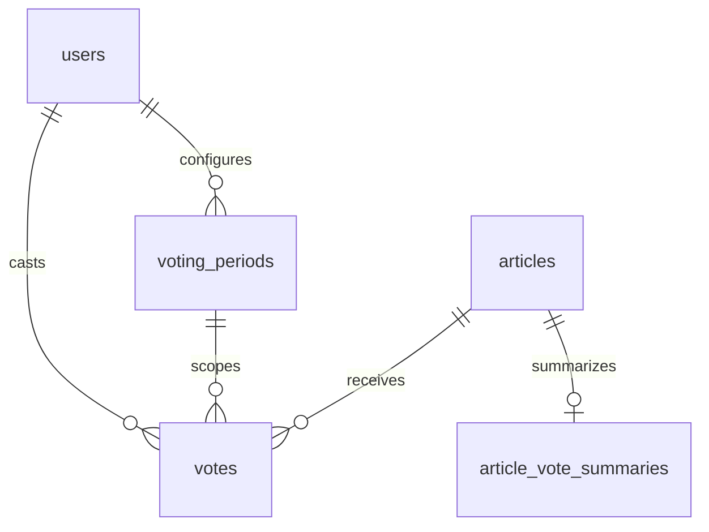

# Voting & Real-Time Ballot — Architecture

**Module:** `App\Modules\Voting`  
**Version:** 1.0  
**Sources:** SRS v1.1 §4.4, §5, §6.3, §7.2; Backend guide §4.4, §5.4, §5.5, §7; Frontend tasks §7, §9

---

## 1. Design decisions

| Decision | Rationale |
|---|---|
| Database unique constraint + InnoDB row locks | Duplicate-vote prevention (`BR-03`, `FR-35`) cannot rely on pre-queries alone. `votes` enforces `UNIQUE(user_id, article_id)` (`votes_one_per_user_article`) inside a transaction with `lockForUpdate()` on the active voting period and summary row. |
| Irrevocable append-only `votes` | Once recorded, votes cannot be changed, withdrawn, or resubmitted (`FR-32`, `FR-33`). `Vote` has `$timestamps = false` and exposes no update or delete endpoints. |
| Derived `article_vote_summaries` cache | `votes` remains the authoritative record, while `article_vote_summaries` caches per-article totals for fast leaderboard and statistics queries without full `COUNT(*)` table scans. |
| Server-enforced voting windows | `VotingPeriod` boundaries (`starts_at <= now() <= ends_at`) are always checked against database/server time on every `castVote` call (`FR-40`, `FR-41`). |
| Strict `FR-38` tally access control | Unauthenticated guests never see live vote totals or standings. `/articles/{article}/vote-results` and `/leaderboard` require `auth:sanctum`, `active`, and `participant.view_results`. |
| Post-commit domain & broadcast events | `VoteRecorded` and `VotingResultsUpdated` fire strictly after `DB::transaction()` commits. `VotingResultsUpdated` broadcasts on `PrivateChannel('voting-results.{periodId}')` authorized for active users with `participant.view_results`. |
| Polling fallback on shared hosting | When a Reverb/WebSocket daemon is not running (e.g. shared hosting), the frontend gracefully polls `/vote-results`, `/leaderboard`, and `/admin/voting/statistics` every 20 seconds. |

---

## 2. Directory architecture

```text
backend/app/Modules/Voting/
├── Database/
│   ├── Factories/VotingPeriodFactory.php
│   └── Migrations/
│       ├── 2026_01_01_000030_create_voting_periods_table.php
│       ├── 2026_01_01_000031_create_votes_table.php
│       └── 2026_01_01_000032_create_article_vote_summaries_table.php
├── Events/
│   ├── VoteRecorded.php
│   └── VotingResultsUpdated.php
├── Exceptions/VotingException.php
├── Http/
│   ├── Controllers/Api/V1/
│   │   ├── Admin/AdminVotingPeriodController.php
│   │   ├── Me/MyVotesController.php
│   │   ├── LeaderboardController.php
│   │   ├── VoteController.php
│   │   └── VotingStatusController.php
│   ├── Requests/{CastVoteRequest,StoreVotingPeriodRequest,UpdateVotingPeriodRequest}.php
│   └── Resources/{VoteResource,VotingPeriodResource}.php
├── Models/{ArticleVoteSummary,Vote,VotingPeriod}.php
├── Policies/VotePolicy.php
├── Providers/VotingServiceProvider.php
├── Routes/api.php
└── Services/{VotingPeriodService,VotingQueryService,VotingTransactionService}.php
```

Registered in `bootstrap/providers.php`; routes are mounted from `routes/api.php` under `/api/v1`.

---

## 3. Data model

### 3.1 Tables

| Table | Purpose |
|---|---|
| `voting_periods` | ULID, `name`, `starts_at`, `ends_at`, `is_active`, `created_by`, timestamps |
| `votes` | ULID, `user_id`, `article_id`, `voting_period_id`, `created_at` — **append-only** |
| `article_vote_summaries` | `article_id` PK, `vote_count`, `updated_at` — derived read-model summary |

### 3.2 Relationships



### 3.3 Indexes and invariants

- `votes_one_per_user_article`: unique constraint on `(user_id, article_id)` preventing duplicate votes even under concurrent requests.
- `votes` has restricted foreign keys (`restrictOnDelete()`) on `user_id`, `article_id`, and `voting_period_id` to preserve voting records.
- `voting_periods_active_window_index`: compound index on `(is_active, starts_at, ends_at)`.
- `article_vote_summaries_count_index`: index on `vote_count` for leaderboard ordering.
- `VotingPeriodService` deactivates all other periods in a transaction whenever a period is created or activated with `is_active = true`.

---

## 4. Transactional vote-casting flow

`VotingTransactionService::castVote(User $voter, string $articleIdentifier, ?Request $request)`:

1. Verify `$identity->isActive($voter)` and `$identity->hasPermission($voter, 'participant.vote')`; otherwise throw `VotingException::ineligibleVoter()` (`403`, `voter_ineligible`).
2. Resolve the target article via `Article::query()->published()` matching `id` or `slug`; if missing or not `published`, throw `VotingException::articleNotEligible()` (`404`, `article_not_eligible`).
3. Inside `DB::transaction()`:
   - Lock the active `VotingPeriod` (`lockForUpdate()`). Throw `VotingException::periodNotConfigured()` (`422`, `voting_period_inactive`) if none is active, or `VotingException::periodNotOpen('upcoming' | 'closed')` (`422`, `voting_period_inactive`) if outside `[starts_at, ends_at]`.
   - Insert into `votes`. Catch `UniqueConstraintViolationException` or `QueryException` (`1062` / SQLSTATE `23000` / `23505`) and map to `VotingException::alreadyVoted()` (`409`, `vote_already_cast`).
   - Lock and increment `article_vote_summaries` (or create it using the authoritative `COUNT(*)` on `votes` if first vote).
   - Write immutable audit entry `vote.cast` through `Shared\Contracts\AuditLogger`.
4. After commit, dispatch `VoteRecorded` and broadcast `VotingResultsUpdated`.

---

## 5. Permissions and rate limits

| Capability | Required middleware / permission |
|---|---|
| Check window status | Public (`throttle:voting-read` — 60/min) |
| Cast a vote | `auth:sanctum`, `active`, `permission:participant.vote`, `throttle:voting-cast` (5/min) |
| View live article results & leaderboard | `auth:sanctum`, `active`, `permission:participant.view_results`, `throttle:voting-read` |
| View own vote history | `auth:sanctum`, `active`, `permission:participant.vote`, `throttle:voting-read` |
| Manage voting periods | `auth:sanctum`, `active`, `staff.mfa`, `permission:settings.manage` |
| View voting statistics | `auth:sanctum`, `active`, `staff.mfa`, `permission:settings.manage,analytics.view_all` |

---

## 6. Endpoint contract

All paths are relative to `/api/v1`.

### 6.1 Voting & participant results

| Method | Path | Permission | Purpose |
|---|---|---|---|
| GET | `/voting/status` | Public | Active period details, `status` (`open\|upcoming\|closed`), `is_open`, `server_time` |
| POST | `/articles/{article}/votes` | `participant.vote` | Cast final vote by article ULID or slug (`201` or `409`) |
| GET | `/articles/{article}/vote-results` | `participant.view_results` | Live `vote_count`, `rank`, `has_voted`, and `voting_status` |
| GET | `/me/votes` | `participant.vote` | Caller's cast vote history with timestamps |
| GET | `/leaderboard` | `participant.view_results` | Ranked standings across published articles + `meta.total_votes` |

### 6.2 Administrator orchestration

| Method | Path | Permission | Purpose |
|---|---|---|---|
| GET | `/admin/voting-periods` | `settings.manage` | Paginated list of voting periods |
| POST | `/admin/voting-periods` | `settings.manage` | Create voting period (`ends_at > starts_at`) |
| GET | `/admin/voting-periods/{voting_period}` | `settings.manage` | Inspect voting period |
| PATCH | `/admin/voting-periods/{voting_period}` | `settings.manage` | Update period name, dates, or active state |
| POST | `/admin/voting-periods/{voting_period}/activate` | `settings.manage` | Activate period and deactivate all others |
| GET | `/admin/voting/statistics` | `settings.manage` or `analytics.view_all` | Total votes, unique voters, top articles, category breakdown, 14-day activity |

### 6.3 Response shapes

```json
// POST /articles/{article}/votes (201 Created)
{
  "data": {
    "vote": {
      "id": "01J...",
      "article_id": "01J...",
      "voting_period_id": "01J...",
      "created_at": "2026-11-20T04:15:00+00:00"
    },
    "article_id": "01J...",
    "vote_count": 42,
    "voting_period_id": "01J..."
  }
}
```

Full schemas: `openapi/openapi.yaml` (tag `Voting`).

---

## 7. Events & real-time broadcasting

| Event | Transport | Payload |
|---|---|---|
| `VoteRecorded` | Internal Laravel event | `Vote $vote`, `int $voteCount` |
| `VotingResultsUpdated` | `ShouldBroadcastNow` on `private-voting-results.{periodId}` | `period_id`, `article_id`, `vote_count`, `updated_at` |

Channel authorization in `VotingServiceProvider::boot()` verifies `$user->isActive() && $user->hasPermission('participant.view_results')`.

---

## 8. Audit trail

| Action | Recorded on |
|---|---|
| `vote.cast` | Successful vote transaction (`article_id`, `voting_period_id`) |
| `voting_period.created` | Period creation (`name`, `starts_at`, `ends_at`, `is_active`) |
| `voting_period.updated` | Period modification |
| `voting_period.activated` | Period activation |

---

## 9. Test strategy

| Suite | Coverage |
|---|---|
| `VoteCastingTest` | Valid vote persistence, summary increment, audit log, `VoteRecorded`/`VotingResultsUpdated` dispatch, multi-article voting, slug lookup, `409` duplicate rejection, DB unique-constraint collision handling, `404` for non-published statuses, 5/min rate limit (`429`) |
| `VotingWindowTest` | Missing active period (`422`), server-time boundary transitions (`upcoming` -> `open` -> `closed`), inactive period rejection |
| `VoteAuthorizationAndResultsTest` | Guest `401` across vote/results/leaderboard/me-votes (`FR-29`, `FR-38`), non-participant & inactive user `403`, live rank/tally accuracy, isolated `/me/votes` |
| `AdminVotingPeriodTest` | Admin RBAC & mandatory TOTP MFA (`staff.mfa`), creating/updating/activating periods (single-active invariant), invalid date-range `422`, aggregated `/admin/voting/statistics` |

Commands:

```bash
php -d extension=pdo_sqlite -d extension=sqlite3 vendor/bin/pest tests/Feature/Modules/Voting
php vendor/bin/pint --test app/Modules/Voting tests/Feature/Modules/Voting
```

---

## 10. Frontend integration

- `Frontend/src/services/votingService.ts` wraps all `/voting/status`, `/articles/{id}/votes`, `/articles/{id}/vote-results`, `/me/votes`, `/leaderboard`, and `/admin/voting-*` endpoints, unwrapping `{ data, meta? }` envelopes.
- `Frontend/src/store.tsx` maintains `votingStatus`, `voteRecords`, and async `castVote()` handling `201`, `409`, `422`, `401`, and offline states.
- `Frontend/src/pages/PublicPages.tsx` (`ArticleDetail`, `Leaderboard`), `ArticleCard.tsx`, and `Home.tsx` enforce `FR-38` by withholding raw vote tallies from unauthenticated visitors and polling live results every 20 seconds when authenticated.
- `Frontend/src/pages/Participant.tsx` renders real `voteRecords` timestamps in `MyVotes` and ballot progress in `Dashboard`.
- `Frontend/src/pages/Admin.tsx` connects `VotingManagement` to voting-period CRUD/activation with explicit confirmation prompts and wires `AdminOverview` and `Results` to `/admin/voting/statistics`.

